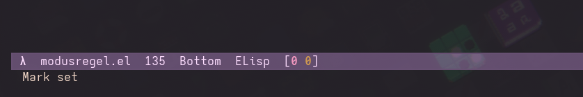
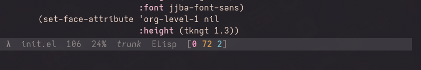

#+title: modusregel
#+author: Josep Bigorra
#+email: jjbigorra@gmail.com
#+language: en

[[https://jointhefreeworld.org/ggg/dist/emacs-lisp.svg]] [[https://jointhefreeworld.org/ggg/dist/license-gpl3+.svg]]    [[https://jointhefreeworld.org/ggg/dist/license-fdl13+.svg]] 

/modusregel/ means mode line in the Dutch language.

A clean, simple, elegant and beautiful mode line for Emacs, with customization and performance in mind.

If you like my work, please support me by [[https://bmc.link/jjbigorra][buying me a cup of coffee ☕]] so I can continue with a lot of motivation.

----------------------

Bear in mind modusregel completely replaces Emacs' original mode line, and as such, integrating certain modeline packages will take a different approach. Read further for more information.

--------------------------------

* Installing

This package is not (yet) available in popular Emacs repositories such as MELPA or ELPA.
An example installation with Elpaca:
#+begin_src emacs-lisp
  (use-package modusregel
    :ensure (:host codeberg :repo "jjba23/modusregel" :branch "trunk")
    :config
    (setq-default mode-line-format modusregel-format))
  #+end_src

*Note*: remember that mode-line-format is window-local, this means that to persist changes and set it globally, one must use ~setq-default~ and for tweaking and experimenting, change it temporarily to ~setq~.

#+begin_src emacs-lisp
  ;; window only
  (setq mode-line-format modusregel-format)
  ;; global
  (setq-default mode-line-format modusregel-format)
#+end_src

------------------------  
  
* Licensing

modusregel and all of its source code are free software, licensed under the GNU General Public License v3 (or newer at your convenience).

https://www.gnu.org/licenses/gpl-3.0.html

The documentation and examples, including this document, which are provided with modusregel, are all licensed under the GNU Free Documentation License v1.3 (or newer at your convenience).

https://www.gnu.org/licenses/fdl-1.3.html

---------

* Code of conduct

This project adheres to the jointhefreeworld code of conduct. Find it here:

https://jointhefreeworld.org/blog/articles/personal/jointhefreeworld-code-of-conduct/index.html

In summary, we foster an inclusive, respectful, and cooperative environment for all contributors and users of this free software project. Inspired by the ideals of the GNU Project, we strive to uphold freedom, equality, and community as guiding principles. We believe that collaboration in a community of mutual respect is essential to creating excellent free software.

--------------

* modusregel project

Contributing to free software is a uniquely beautiful act because it embodies principles of generosity, collaboration, and empowerment.

We welcome everyone to feel invited to the modusregel project, and encourage active contribution in all forms, to improve it and/or suggest improvements, brainstorm with me, make it more modular/flexible, etc, feel free to contact me <jjbigorra@gmail.com> to chat, discuss or report feedback.

Find here the Backlog and Kanban boards for my Emacs packages: https://lucidplan.jointhefreeworld.org/tickets/emacs-pkg

--------------------------

* Using with keycast

modusregel 
If you'd like to use this package in combination with ~keycast~ you can do this:
#+begin_src emacs-lisp
  (use-package keycast
    :ensure t
    :hook (after-init . keycast-mode)
    :config
    (define-minor-mode keycast-mode
      "Show current command and its key binding in the mode line."
      :global t
      (if keycast-mode
          (add-hook 'pre-command-hook 'keycast--update t)
        (remove-hook 'pre-command-hook 'keycast--update))))

  (use-package modusregel
    :ensure (:host codeberg :repo "jjba23/modusregel" :branch "trunk")
    :after (keycast)
    :config
    (add-to-list 'modusregel-format '("" keycast-mode-line))
    (setq-default mode-line-format modusregel-format))
#+end_src
